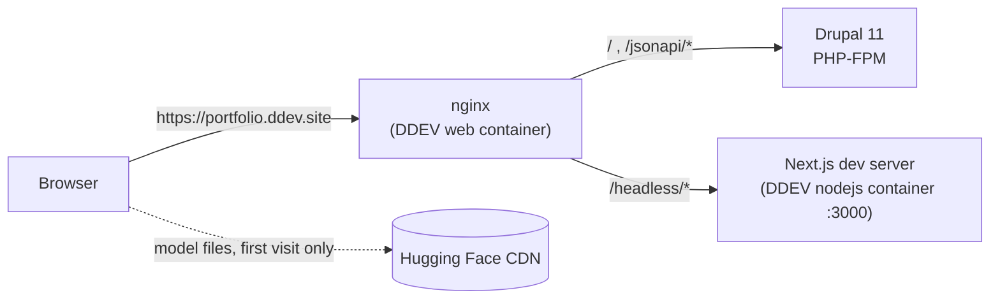

# Portfolio Tech Lab: headless Next.js on Drupal JSON:API

[](https://github.com/Ricardo0597/portfolio-headless/actions/workflows/ci.yml)

The **Tech Lab** is the headless side of my Drupal portfolio ([Ricardo0597/portfolio](https://github.com/Ricardo0597/portfolio)).
It is a Next.js app served at `/headless` on the same domain as the Drupal site. It reads projects and skills from Drupal's
JSON:API and turns them into two things a CMS page can't easily do:

- **Tech Constellation** (`/headless/constellation`): a D3 force-directed graph of my skills, linked by the projects that use
  them together.
- **Ask My Portfolio** (`/headless/search`): natural-language search over projects and skills, with AI embeddings computed
  **in the visitor's browser**. There is no AI API, no key and no server cost.

| Aspect | What it uses |
|---|---|
| Framework | Next.js 16 (App Router, webpack), React 19, client-side rendered pages |
| Data | Drupal 11 core JSON:API: `include`, sparse fieldsets and `filter[status]=1`, fetched from the same origin |
| Graph | D3 v7: force simulation, zoom and pan, drag, zoom-to-fit, neighbour highlighting |
| Search | [Transformers.js](https://huggingface.co/docs/transformers.js) (`@huggingface/transformers`) running `Xenova/all-MiniLM-L6-v2` (8-bit, about 23 MB) on WebAssembly, with cosine similarity over mean-pooled, normalised embeddings |
| Tests | Vitest, Testing Library and jsdom; CI runs `npm audit`, the tests and a production build |

## How the two apps fit together



- **One origin.** nginx sends `/headless/*` to the Next.js container ([`nextjs-proxy.conf`](https://github.com/Ricardo0597/portfolio/blob/main/.ddev/nginx/nextjs-proxy.conf))
  and everything else to Drupal. The app calls `/jsonapi/...` with relative URLs, so there is no CORS setup and no API host
  to configure.
- **Base path.** `basePath: '/headless'` in `next.config.mjs` makes Next.js routes and assets live under the proxied prefix.
- **Data stays in Drupal.** Editors manage projects, skills and technologies in Drupal. The Tech Lab fetches them on each
  visit and keeps nothing.

## Drupal JSON:API integration

`src/lib/portfolio.js` makes two requests, in parallel:

| Request | Why |
|---|---|
| `/jsonapi/node/project?include=field_stack&filter[status]=1&fields[node--project]=title,field_summary,field_stack,path` | Published projects with their technology terms, in one response |
| `/jsonapi/node/skill?include=field_category&filter[status]=1&fields[node--skill]=title,field_skill_level,field_category,path` | Published skills with their category |

`normalizePortfolio()` then:

1. Indexes `included` by id and reads relationships, single or multiple.
2. Links **skills to projects by name**: the skill "PHP" matches the `technology_stack` term "PHP" on a project, ignoring
   case. A skill's `projectCount` is the number of projects that use it.
3. Builds the **graph**. There is one node per skill, weighted `projectCount × 2 + level`, and one edge per pair of skills
   used in the same project. An edge's strength is the number of projects the two skills share.
4. Builds the **search items**: projects (title and summary) and skills (title).

It falls back to `/node/<id>` when a node has no path alias, and to the "Other" category when a skill has none. A response
without a `data` array raises a clear error ("check that JSON:API module is enabled").

## Tech Constellation

`src/components/Constellation.js` draws the graph with D3.

- **Node radius** follows `√weight`, and **colour** follows the skill category (Tableau 10).
- **Forces:** link distance shrinks as an edge gets stronger, with many-body repulsion, centring and collision by radius.
- **Interaction:** drag nodes, zoom and pan (0.15×–8×), and zoom-to-fit once the simulation settles. Clicking a node fades
  everything not connected to it and opens a side panel with its category, level and the projects that use it.
- The graph is built once per data set. Selecting a node only changes opacity, so the layout never restarts.

## Ask My Portfolio: search in the browser

`src/hooks/useEmbeddings.js`:

1. **Loads the model on demand.** `import('@huggingface/transformers')` keeps the library out of the initial bundle. The
   model downloads from the Hugging Face CDN on the first visit, and the browser cache serves it afterwards.
2. **Embeds every search item** (`pooling: 'mean'`, `normalize: true`) and shows progress ("Building knowledge base…
   (3/24)").
3. **Answers a query** by embedding it and ranking items with cosine similarity (`src/lib/search.js`), returning the top 5
   with a match score.

**Failure handling.** A failed download, an initialisation error (for example, no WebAssembly) or a download that takes
more than 60 seconds ends in an error state, not an endless "Loading AI model…". The page shows "Search is unavailable: …"
with a **Try again** button, and the input stays disabled. A query that fails shows "Search failed: …" and the button
recovers. If Drupal's JSON:API can't be reached, both pages show the error with a retry.

## Run it

### With the Drupal site (recommended)

The Drupal repo includes this app as the `nextjs/` git submodule, and DDEV runs both:

```bash
git clone --recurse-submodules git@github.com:Ricardo0597/portfolio.git
cd portfolio
ddev start        # also starts the nodejs service: npm install && npm run dev
```

Then open **https://portfolio.ddev.site/headless**. See the
[portfolio README](https://github.com/Ricardo0597/portfolio#local-setup) for the Drupal install steps. The `nodejs`
service is defined in `.ddev/docker-compose.nodejs.yaml` and runs as your user, so `node_modules` stays writable from the
host.

### On its own

```bash
ONNXRUNTIME_NODE_INSTALL=skip npm install
npm run dev       # http://localhost:3000/headless
```

`ONNXRUNTIME_NODE_INSTALL=skip` stops `onnxruntime-node`, a server-side dependency of transformers.js, from downloading
CUDA binaries from NuGet on Linux x64. This app runs ONNX only in the browser (`onnxruntime-web`), and webpack aliases the
Node package away. CI and the DDEV container set the same variable.

Without Drupal on the same origin, the JSON:API requests fail, and the pages show the error with a retry button. This is
expected, and useful for checking the failure states.

## Tests

```bash
npm test          # Vitest, once
npm run test:watch
npm run build     # production build (webpack)
```

| Suite | Covers |
|---|---|
| `src/lib/portfolio.test.js` | JSON:API normalisation: summaries, path fallback, case-insensitive skill ↔ technology matching, node weights, edge strengths, search items, request URLs, HTTP errors |
| `src/lib/search.test.js` | Cosine similarity, ranking and top K, the timeout helper |
| `src/hooks/useEmbeddings.test.js` | Model load and search with a fake pipeline; download failure, stalled download (timeout), embedding failure, retry |
| `src/hooks/usePortfolioData.test.js` | Loading, HTTP and network errors, reload |
| `src/components/SearchBox.test.jsx` | Error state with retry, progress, results and scores, failed search recovery, no search before ready |

The model is always mocked: tests never download it. CI (`.github/workflows/ci.yml`) runs `npm audit` on production
dependencies, the tests and a production build on every push and pull request. It never deploys.

## Project structure

```
src/
├── app/
│   ├── layout.js               banner, navigation, metadata
│   ├── page.js                 Tech Lab landing
│   ├── constellation/page.js   graph page
│   └── search/page.js          search page
├── components/                 Constellation, ConstellationPanel, SearchBox, LoadError, Nav, Banner, InfoBadge
├── hooks/
│   ├── usePortfolioData.js     fetch + normalise, with error and reload
│   └── useEmbeddings.js        model lifecycle: idle → loading → embedding → ready | error
├── lib/
│   ├── portfolio.js            JSON:API URLs and normalisation (pure)
│   └── search.js               cosine, ranking, timeout (pure)
└── test/fixtures.js            JSON:API fixtures and a fetch stub
```

## Known limitations

| Area | Limitation |
|---|---|
| Content links | Project and skill pages are currently disabled on the Drupal site, so links from the panel and results redirect to the portfolio front page. The data itself is still served by JSON:API |
| First visit | Search downloads about 23 MB of model files from a third-party CDN (Hugging Face) before it can answer |
| Rendering | All pages are client-side rendered; there is no static or server rendering of Drupal content |
| End-to-end tests | The Drupal repo's Playwright suite does not cover `/headless` yet |

## License

The code is licensed under the [GNU General Public License v2.0 or later](LICENSE), the same as the
[Drupal portfolio](https://github.com/Ricardo0597/portfolio). The content it displays (projects, skills, profile data)
comes from that site and is not covered by this license.
